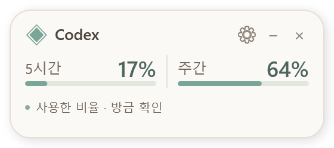
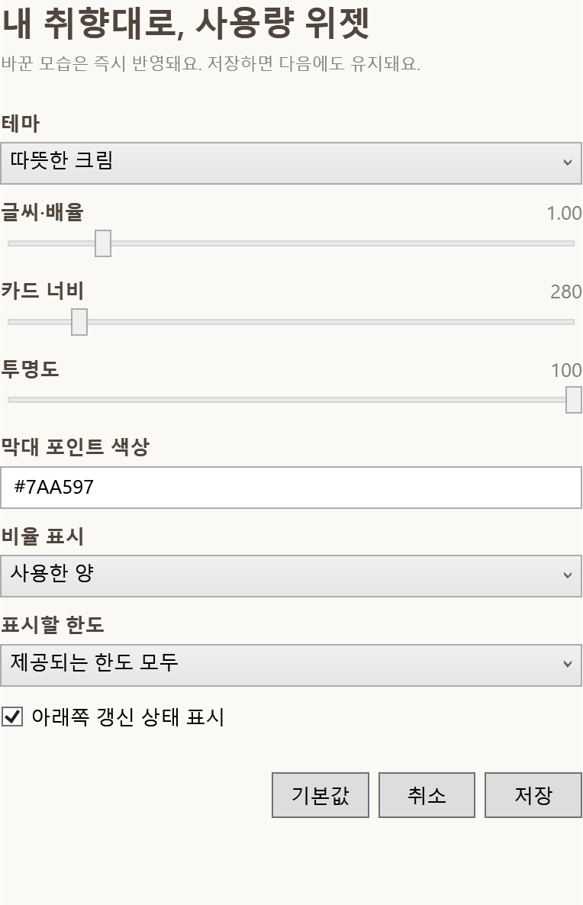

# AI Usage Widget Skill

Customizable floating usage cards for **Codex** and **Claude / Cowork** on Windows. Includes an installable agent skill, a dependency-free WPF widget, appearance settings, and an experimental Claude desktop bridge.

Windows x64 · MIT · No additional model calls · Korean settings UI



## 어떤 도구인가요?

AI 앱을 사용할 때 창 위에 사용량 카드를 띄웁니다. 다른 앱을 선택하면 숨겨지고, 제목을 끌어서 위치를 바꿀 수 있습니다. **공식 앱 파일을 수정하지 않는 별도 위젯**입니다.

- **Codex:** 기존 로그인으로 계정 사용량을 2분마다 조회합니다. 계정에 실제 제공되는 한도만 표시합니다.
- **Claude / Cowork:** 호환되는 데스크톱 **Mods SDK**와 열린 Code 세션이 필요한 실험적 연결입니다. 모든 Claude 버전에서 자동 설치되는 기능은 아닙니다.
- **꾸미기:** 위젯의 ⚙ 버튼에서 테마, 포인트 색상, 글씨·배율, 너비, 투명도, 사용한 양/남은 양, 표시할 한도와 상태 줄을 바꿉니다. 실시간 미리보기와 저장·취소·기본값을 지원합니다.



## 스킬로 설치하기

스킬 설치를 지원하는 Codex에서 다음처럼 요청하세요.

```text
https://github.com/Hamsterchuchu/ai-usage-widget-skill 저장소의
skills/ai-usage-widget 스킬을 설치해줘.
```

직접 설치하려면 `skills/ai-usage-widget` 폴더를 스킬 디렉터리에 복사합니다. Codex는 `~/.codex/skills/ai-usage-widget`, Claude Code는 `~/.claude/skills/ai-usage-widget`에 둘 수 있습니다. 기존 동명 스킬이 있으면 먼저 확인하세요. 설치 후 앱에서 스킬을 다시 불러온 뒤 요청합니다.

```text
$ai-usage-widget Codex 사용량 위젯을 설치하고, 다크 테마에 글씨를 조금 크게 해줘.
```

스킬 설치와 Claude의 **사용량 브리지 설치는 별개**입니다. Claude Code에 이 스킬을 넣는 것만으로 Cowork 사용량이 연결되지는 않습니다. 아래 호환 조건을 확인해 주세요.

## 직접 빌드하고 실행하기

Windows x64와 .NET Framework 4.x가 필요합니다. Node나 Python은 위젯 실행에 필요하지 않습니다.

```powershell
git clone https://github.com/Hamsterchuchu/ai-usage-widget-skill.git
cd ai-usage-widget-skill
./skills/ai-usage-widget/scripts/Build-Widget.ps1
./skills/ai-usage-widget/scripts/Start-Widget.ps1 -Provider codex
```

`artifacts/AIUsageWidget.exe`가 만들어집니다. 배포 저장소에는 실행 파일을 넣지 않고 소스에서 빌드합니다. Codex 앱을 선택하면 카드가 나타납니다. 위치와 설정은 `%LOCALAPPDATA%\AIUsageWidget\codex`에 저장됩니다. `-DataDirectory`로 다른 위치를 지정할 수 있습니다.

- 제목 끌기: 이동 · `−`: 접기 · `+`: 펼치기 · `×`: 위젯만 종료
- Windows 재시작 후에는 다시 실행해 주세요. 시작 프로그램을 자동 등록하지 않습니다.
- 설정에서 `남은 양`을 선택하면 `100 - 사용한 비율`을 표시합니다.
- 한도 정보가 없거나 초기화 직후 갱신 전이면 `—`로 표시합니다.
- 위젯의 각 퍼센트는 대화 하나의 토큰 수가 아닌 **계정 전체 한도**입니다.

## Claude / Cowork 연결 조건

프로토타입은 Claude desktop의 Mods SDK 환경(Claude Code 2.1.308)에서 검증했습니다. `$.session.authorize`, `$.http.fetch`, `$.clock.every`, `$.fs.write`가 지원되어야 합니다. 일반 CLI 훅과 `hooks.modules` 방식은 다릅니다.

```powershell
./skills/ai-usage-widget/scripts/New-ClaudeBridge.ps1
./skills/ai-usage-widget/scripts/Start-Widget.ps1 -Provider claude
```

생성된 `artifacts/claude-usage-bridge`를 해당 버전이 지원하는 로컬 플러그인/Mods 설치 방식으로 설치하고, Code 세션 하나를 열어 두어야 Cowork에서도 갱신됩니다. 지원하지 않는 버전에는 이 브리지를 설치할 수 없습니다. 앱 파일을 패치하는 우회 방법은 포함하지 않습니다. 자세한 경로 설정과 진단은 [설치 참고](skills/ai-usage-widget/references/setup.md)를 보세요.

## 개인정보와 비용

- 비밀번호, 토큰, 쿠키, 대화 내용은 위젯이 읽거나 저장하지 않습니다. 인증은 기존 앱/엔진이 처리합니다.
- 로컬 `usage.json`에는 한도별 사용 비율, 기간, 초기화 시각과 확인 상태만 기록합니다. 개인 사용량과 설정 파일은 Git에서 제외됩니다.
- Codex의 조회 연결은 `initialize`, `initialized`, `account/rateLimits/read`만 사용합니다. 대화나 모델 작업을 만들지 않습니다.
- Claude 브리지는 사용량 조회 API만 호출합니다. 베타 API와 SDK의 변경에 따라 수정이 필요할 수 있습니다.
- 계정 사용량 요청은 기본 2분 간격입니다. 오류 시 재시도 간격을 늘립니다. 텔레메트리를 추가하지 않습니다.

## 개발 및 검증

```powershell
./tests/Test-Widget.ps1
node --test tests/bridge.test.mjs
```

데이터 검증 8개, 커스터마이징 검증 8개, 브리지 검증 6개와 데모 렌더링을 포함합니다. GitHub Actions에서도 Windows 빌드와 검증을 실행합니다. 데모 이미지는 **17% / 64%의 가상 값**이며 실제 계정 정보가 아닙니다.

직접 미리보려면:

```powershell
./skills/ai-usage-widget/scripts/Start-Widget.ps1 -Preview -Demo
```

소스는 `skills/ai-usage-widget/assets/`, 실행·설치 도우미는 `scripts/`, 에이전트 안내는 `SKILL.md`에 있습니다. Windows용이며 macOS와 Linux GUI는 지원하지 않습니다. OpenAI·Anthropic의 공식 제품이나 Claude Tuner의 배포본이 아닙니다.
